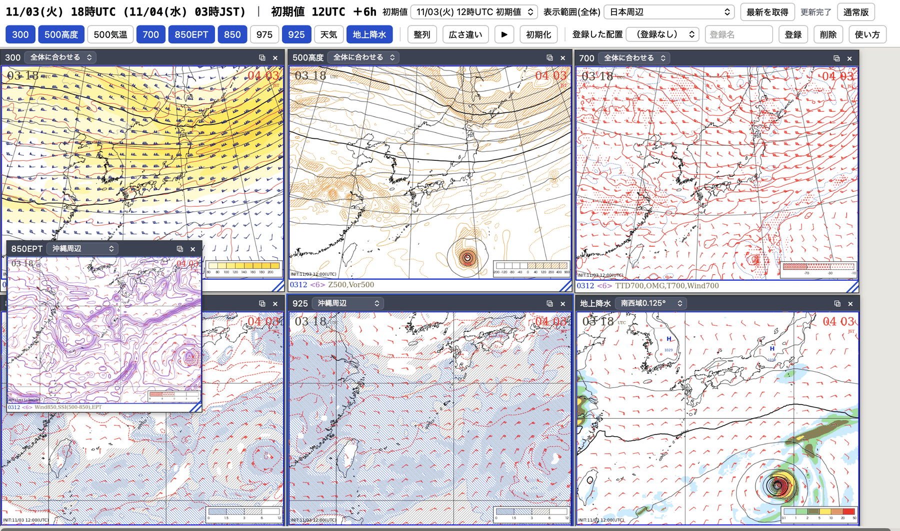

# gsm_chart_web — GSM天気図Webビューア

> **⚠️ 調査用のプロジェクトです。**
> - 気象庁 全球モデル(GSM)のデータを、個人が**調査・検証・学習のために**天気図化するツールです。完成品や公開サービスではありません。
> - **Webアプリはローカル（自分のPC、`127.0.0.1`）で動かす前提**です。公開サーバーには置いていません（公開サーバー向けの別プロジェクトは [nwp_chart_web](https://github.com/masauehr/nwp_chart_web)＝ECMWF/GFS版）。
> - このリポジトリに**データ（GRIB2）や、作図した画像のファイルは含まれません**（説明用の画面例のスクリーンショット1枚 `docs/images/board.png` を除く）。データは各自が配信元（京都大学生存圏研究所 RISH／気象庁）から取得し、**配信元の利用条件に従ってください**（再配布・公開は各自で確認）。
> - 作図の正確さ・最新性は保証しません。**防災・安全に関わる判断には、気象庁の公式情報を使ってください。**

> **後継**: ECMWF（IFS・AIFS）・GFS と**同じ画面で比較できる版**を [nwp_chart_web](https://github.com/masauehr/nwp_chart_web) に作りました。そちらに GSM を**ローカル専用モデル**として追加してあります（公開サイトには載せません）。このリポジトリは単独で動く旧版として残しています。

詳しくは [gsm-chart-web.md](gsm-chart-web.md) を参照。設計・ロードマップは [DESIGN.md](DESIGN.md)。

気象庁全球モデル（GSM）の GRIB2（京都大学 RISH 配信）から、気象庁内部ビューア風の天気図を作成し、ブラウザで閲覧するアプリ。

## ローカルでの起動方法

### 前提
- Python は conda 環境 `met_env_310`（pygrib・cartopy・metpy・scipy・requests が入っている環境）を使います。
- **`python3` と打つと別の環境（`~/projects/.venv`）になることがあり、その場合は `ModuleNotFoundError` になります。** 下の例のように `/opt/anaconda3/envs/met_env_310/bin/python` を直接指定するのが確実です（`conda activate met_env_310` した後の `python` でも同じです）。

### 手順（初回）
```bash
cd ~/projects/gsm_chart_web

# 1) 天気図を作る（初回だけ必要。最新の初期値を京大RISHから取得して作図。FT0〜72hで数百MB・10分前後）
/opt/anaconda3/envs/met_env_310/bin/python make_charts.py --latest

# 2) サーバーを起動する（このターミナルは起動したままにする。止めるときは Ctrl+C）
/opt/anaconda3/envs/met_env_310/bin/python server.py

# 3) ブラウザで開く
#    通常版   : http://127.0.0.1:8780/
#    画用紙版 : http://127.0.0.1:8780/board/
```

### 2回目以降（作成済みの画像を見るだけ）
手順の 2) と 3) だけです。**表示するだけならダウンロードは発生しません**（作成済みの画像を読むだけ）。

### 最新データに更新する
- 画面ヘッダーの **「最新を取得」** ボタン（サーバーが裏で取得・作図し、完了すると自動で切り替わります）。
- またはコマンド: `python make_charts.py --latest`（取得済みのファイルは再取得しません）。

### バックグラウンドで起動・停止する場合
```bash
nohup /opt/anaconda3/envs/met_env_310/bin/python server.py > /tmp/gsm_server.log 2>&1 &   # 起動
kill $(lsof -ti :8780)                                                                      # 停止
```

### うまくいかないとき
| 症状 | 対処 |
|---|---|
| `ModuleNotFoundError`（pygrib など） | `python3` ではなく `/opt/anaconda3/envs/met_env_310/bin/python` を使う |
| `Address already in use`（ポートが使用中） | `python server.py --port 8781` のように別のポートにする（URLのポートも変える） |
| 画面に「manifest.json を読めません」「天気図がまだありません」 | 手順 1) の `make_charts.py` を先に実行する |
| 画像が古い | 「最新を取得」を押す。RISHに新しい初期値がまだ無い場合は作られない |
| 初期値のドロップダウンが変わらない | ブラウザを再読み込み（Cmd+R） |

- サーバーは `127.0.0.1`（自分のPCだけ）で待ち受けます。**他の端末・インターネットには公開されません。**
- 比較版（ECMWF・GFS・AIFS と GSM を同じ画面で比較）は後継の [nwp_chart_web](https://github.com/masauehr/nwp_chart_web) で、ポート 8790 を使うため、この版と同時に起動できます。

## 最新データの取得

画面ヘッダーの **「最新を取得」** ボタンで随時ダウンロード・作図（定期実行は使っていない）。コマンドなら `python auto_update.py`（`--dry-run` で確認）。

`python auto_update.py` で新しい初期値を検知して取得・作図（`--dry-run` で確認）。launchd での1時間おき実行の手順は [gsm-chart-web.md](gsm-chart-web.md) を参照。

## 画面

- 通常版: <http://127.0.0.1:8780/> … 1枚ずつ閲覧
- 画用紙版: <http://127.0.0.1:8780/board/> … 各高度の図を並べ、マウスで移動・拡大縮小、↑↓キーで予報時間を前後

### 画用紙版の画面例



*画面例: 2026-11-03 12UTC 初期値の GSM、予報時間 +6h（11/3 18UTC＝11/4 03JST）。図は気象庁 全球モデル(GSM)の数値予報データを本ツールで作図したもので、気象庁の公式な図ではありません。*

**上部メニュー（2段）**

| 段 | 要素 | 説明 |
|---|---|---|
| 1段目 | 日時表示 | 予報の有効時刻（UTC と JST）、初期値、予報時間（FT）。例:「11/03(火) 18時UTC (11/04(水) 03時JST) ｜ 初期値 12UTC ＋6h」 |
| | 初期値 | 表示する初期値を選ぶ（11/3 12UTC など） |
| | 表示範囲(全体) | 全ての図の表示範囲（日本周辺・沖縄周辺・東アジア・日本域0.125°・南西域0.125°）。既定では全図がこの範囲に揃う |
| | 最新を取得 | 気象庁GSMの最新初期値を取得して作図（右隣に進捗・結果が出る。例:「更新完了」） |
| | 通常版 | 1枚ずつ見る画面へ移動 |
| 2段目 | 図のボタン（300・500高度・500気温・700・850EPT・850・975・925・天気・地上降水） | 青＝表示中。押すと表示・非表示を切り替える |
| | 整列 / 広さ違い / ▶ / 初期化 | 表示中の図を敷き詰める／選択中の図を他の範囲でも並べる／予報時間を自動再生／配置を初期状態に戻す |
| | 登録した配置・登録名・登録・削除 | 今の配置（図・範囲・位置・大きさ）に名前を付けて保存し、後で呼び出す |
| | 使い方 | 操作説明を表示 |

**図（パネル）**

- 左上が最も高い高度（300hPa）、右下が地上（地上降水）になる並びが既定（この例は 300 → 500高度 → 700 → 850 → 925 → 地上降水）。
- 各図の**タイトル帯**: 図の名前（300、500高度…）、**その図だけの表示範囲**（既定は「全体に合わせる」。例では 925 が「沖縄周辺」、地上降水が「南西域0.125°」）、⧉（別の範囲で複製＝広さ違い）、✕（閉じる）。タイトル帯をドラッグして移動、右下の ▨ をドラッグして大きさ変更、マウスホイールで拡大縮小。
- 例の左下に重なっている小さな図は、別の範囲（沖縄周辺）で出した **850EPT**。図は重ねて置け、クリックした図が最前面になる。
- 図の中: 左上に有効時刻（UTC）、右上に JST、左下に初期値（`INIT:11/03 12:00(UTC)`）、下の帯に「初期値日時 ＜予報時間＞ 図の種類」（例: `0312 <6> Z500,Vor500`）、右下に凡例。
- 画面右側・下側の空きは「画用紙」の余白。図は自由に置ける。

操作の一覧は [gsm-chart-web.md](gsm-chart-web.md) を参照。

## 図種・地域

- 図種: 地上（降水）/ 地上（天気・SSI）/ 500hPa 高度・渦度 / 500hPa 気温・湿数 / 300hPa / 850 / 700 / 925 / 975hPa / 850hPa EPT・SSI
- 地域: 日本周辺 / 沖縄周辺 / 東アジア広域（全球0.5°・6時間毎）、日本域 / 南西域（0.125°・**3時間毎**）

## データ出典

気象庁 全球モデル(GSM) GPV を京都大学生存圏研究所 RISH のアーカイブから取得。データそのものは本リポジトリに含めない。利用条件は配信元で確認すること。
